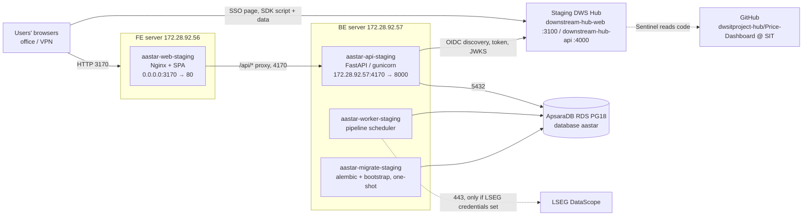

# 06 — Staging Deployment Guide (Alibaba Cloud, shared servers)

| | |
|---|---|
| **Date** | 2026-11-05 |
| **Environment** | Staging (`APP_ENV=sit`, branch **`SIT`**) |
| **Servers** | FE `172.28.92.56` · BE `172.28.92.57` · ApsaraDB `pgm-d9jx9o06qae8gf3h.pgsql.ap-southeast-5.rds.aliyuncs.com` |
| **App URL** | **http://172.28.92.56:3170** |
| **Integrations** | DWS Hub SSO (strict OIDC) · Hub SDK v2 · Sentinel |
| **Kit** | [`deploy/staging/`](../deploy/staging/) — compose files, env templates, `deploy.sh` |
| **Rehearsed** | The full layout was rehearsed on a laptop (PG18 with a non-superuser "privileged" account standing in for ApsaraDB) on 2026-11-05. See §13 |

Both servers already host many applications in Docker. This guide adds AASTAR as **four containers** (`aastar-web-staging` on FE; `aastar-api-staging`, `aastar-worker-staging` and the one-shot `aastar-migrate-staging` on BE) and **one database** on the shared ApsaraDB instance. It changes nothing belonging to the other applications.

---

## 1. Topology



| Container | Server | Image | Host port | Restart |
|---|---|---|---|---|
| `aastar-web-staging` | FE 172.28.92.56 | `aastar-frontend:<sha>` | `0.0.0.0:3170` → 80 | unless-stopped |
| `aastar-api-staging` | BE 172.28.92.57 | `aastar-backend:<sha>` | `172.28.92.57:4170` → 8000 (private IP only) | unless-stopped |
| `aastar-worker-staging` | BE | `aastar-backend:<sha>` | none | unless-stopped |
| `aastar-migrate-staging` | BE | `aastar-backend:<sha>` | none | runs on each deploy, then exits 0 |

Images are built on each server from the `SIT` branch and tagged with the git short SHA. That SHA is also the
SDK's `data-release` and the API's `APP_RELEASE`, so Sentinel reads exactly the code that is running.

## 2. Port selection

The ports come from the `docker ps` output of both servers (5 Nov 2026), following the convention already in
use there: APIs on `41x0`, bound to the private IP, and web on `31x0`.

| Server | Published ports already in use (Docker) | Chosen for AASTAR |
|---|---|---|
| BE 172.28.92.57 | 3000, 3001, 3003, 3010, 3011, 3111, 3121, 4000, 4001, 4010, **4150** (astar-erp), **4160** (ecr), 4200, 5000, 5001, 5003, 5050, 5070, 6380, 8085 | **4170** |
| FE 172.28.92.56 | 2001, 3000, 3001, 3002, 3020, 3030, 3040, 3042, 3050, 3060, 3070, 3080, 3090, 3091, 3100, 3110, 3120, 3130, **3150** (astar-erp), **3160** (ecr), 4041, 4042, 8010, 8080, 8088, 8443 | **3170** |

`docker ps` does not show host processes such as a host Nginx or sshd. Confirm both ports just before the first
deploy. `deploy.sh` repeats this check every time, and refuses to start on a port held by anything other than
its own container.

```bash
ss -ltnp | grep -E ':(4170)\b' || echo "4170 free"      # on BE
```

```bash
ss -ltnp | grep -E ':(3170)\b' || echo "3170 free"      # on FE
```

If a port is taken, change `API_PORT` (BE) or `WEB_PORT` (FE) in the env file. Then update
`API_UPSTREAM`, `APP_BASE_URL`, `APP_ALLOWED_ORIGINS`, `HUB_REDIRECT_URI` and the Hub registration to match.

> **Note:** "AASTAR" (this app, `aastar-*`) and "astar-erp" (an existing app, `astar-erp-*`) are different
> applications. Don't touch the `astar-erp-*` containers.

## 3. Inputs to collect before you start

| # | Item | Who | Used in |
|---|---|---|---|
| I-1 | ApsaraDB **privileged account** name and password (or console access to create accounts) | IT Infra | §5 |
| I-2 | ApsaraDB **engine version ≥ 18** and port (default 5432), and whether SSL is enabled | IT Infra | §5.1 |
| I-3 | Staging Hub **issuer** and browser origin, read from its discovery document | you (§8.1) | `.env.backend`, `.env.frontend` |
| I-4 | Hub Admin access to staging Hub: register the app, issue the SDK key, Sentinel settings | Hub Admin | §8–§10 |
| I-5 | GitHub: rights to add **read-only deploy keys** to `dwsitproject-hub/Price-Dashboard` | repo admin | §6.1 |
| I-6 | First AASTAR admin email | business owner | `.env.backend` |
| I-7 | *(Optional)* LSEG DataScope Select username/password. Without them staging runs in **demo mode** | data owner | `.env.backend` |
| I-8 | Users can reach `172.28.92.56:3170` (office LAN / VPN) | IT Infra | §4 |

## 4. Network and security-group rules

Docker-published ports bypass the host firewall (iptables), so **enforce these in the Alibaba Cloud security
groups**.

| # | From | To | Port | Purpose |
|---|---|---|---|---|
| N-1 | User networks (office/VPN) | FE 172.28.92.56 | **3170/tcp** | The application |
| N-2 | FE 172.28.92.56/32 **only** | BE 172.28.92.57 | **4170/tcp** | `/api` reverse proxy. Nothing else may reach 4170 |
| N-3 | BE 172.28.92.57 | ApsaraDB | 5432/tcp | Database. Also add `172.28.92.57` to the RDS **whitelist** |
| N-4 | BE 172.28.92.57 | Staging Hub `172.28.92.56` | 3010/tcp | OIDC discovery, token, JWKS (server to server) |
| N-5 | User networks | Staging Hub `172.28.92.56` | 3010/tcp | Hub sign-in page, SDK script and SDK data |
| N-6 | FE, BE | github.com:22, Docker Hub, pypi.org, registry.npmjs.org (443) | 22/443 | `git pull` and image builds |
| N-7 | BE | `selectapi.datascope.lseg.com` | 443 | Only with LSEG credentials (I-7) |
| N-8 | BE | `api.anthropic.com` | 443 | Claude API: AI narrative, News extraction, Calendar web search (§16) |
| N-9 | BE | `www.cftc.gov` | 443 | CFTC Commitments of Traders history files, weekly (§16) |

The API trusts `X-Forwarded-For` only from `FORWARDED_ALLOW_IPS=172.28.92.56`, the FE server's Nginx. This
keeps the audit-log IPs and per-IP login rate limits correct, and stops a caller elsewhere in the VPC from
spoofing its address. The rehearsal confirmed both behaviours (§13).

## 5. ApsaraDB (once)

Run these from the **BE server**, which is on the RDS whitelist. The PostgreSQL client runs in a throwaway
`postgres:18` container, so nothing needs installing on the host.

### 5.1 Pre-checks (blocking)

```bash
export RDS_HOST=pgm-d9jx9o06qae8gf3h.pgsql.ap-southeast-5.rds.aliyuncs.com
read -rp 'RDS privileged account: ' RDS_PRIV; read -rsp 'Password: ' PGPASSWORD; echo; export PGPASSWORD
docker run --rm -e PGPASSWORD postgres:18 psql "host=$RDS_HOST port=5432 dbname=postgres user=$RDS_PRIV sslmode=prefer" \
  -c "select version();" -c "\du aastar*" -c "select datname from pg_database where datname='aastar';"
```

| Check | Expected | If not |
|---|---|---|
| `version()` | **PostgreSQL 18.x** | **Stop.** The schema uses `uuidv7()` and VIRTUAL generated columns (PG18 only). Ask IT Infra for a PG18 instance, or a major-version upgrade |
| `\du aastar*` | no rows | Roles exist from an earlier attempt: skip §5.2 and reuse their passwords, or drop them first |
| `aastar` database | no rows | Database exists: confirm it is empty or intended, then skip §5.2 |
| Connection | succeeds | Timeout means the RDS whitelist or security group (N-3). Authentication failure means I-1 |

### 5.2 Create the roles and database

The script is [`deploy/rds/bootstrap_roles.sql`](../deploy/rds/bootstrap_roles.sql). It creates
`aastar_owner` (owns the schema and runs migrations), `aastar_app` (runtime, least privilege,
40 connections) and `aastar_ro` (read-only, 5 connections), then creates the database `aastar`.
Passwords are generated as alphanumeric strings, so they need no URL-encoding in the DB URLs.

```bash
cd /opt/aastar-price-dashboard         # the checkout from §6.1 (clone it first)
export OWNER_PW=$(openssl rand -base64 24 | tr -d '+/=') APP_PW=$(openssl rand -base64 24 | tr -d '+/=') RO_PW=$(openssl rand -base64 24 | tr -d '+/=')
docker run --rm -e PGPASSWORD -v "$PWD/deploy/rds:/sql:ro" postgres:18 \
  psql "host=$RDS_HOST port=5432 dbname=postgres user=$RDS_PRIV sslmode=prefer" \
  -v owner_pw="$OWNER_PW" -v app_pw="$APP_PW" -v ro_pw="$RO_PW" -f /sql/bootstrap_roles.sql
```

The expected output is `CREATE ROLE` ×3, `GRANT ROLE`, `CREATE DATABASE`, then the grants. Keep this shell
open: §6.2 writes `$OWNER_PW` and `$APP_PW` into the env file. Store all three passwords in the team vault.
`aastar_ro` is for reporting and support access only.

**Without a privileged account (console alternative).** In the RDS console, **Accounts**: create standard
accounts `aastar_owner`, `aastar_app` and `aastar_ro`. Then **Databases**: create `aastar` with owner
`aastar_owner`. Then connect as `aastar_owner` to database `aastar` and run:

```sql
REVOKE ALL ON DATABASE aastar FROM PUBLIC;
GRANT CONNECT ON DATABASE aastar TO aastar_app, aastar_ro;
REVOKE CREATE ON SCHEMA public FROM PUBLIC;
ALTER DATABASE aastar SET timezone TO 'UTC';
```

Then, as each role in turn: `ALTER ROLE aastar_app SET statement_timeout = '120s';` (as `aastar_app`) and
`ALTER ROLE aastar_ro SET default_transaction_read_only = on;` (as `aastar_ro`).

The tables and the least-privilege grants come later, from the migrations run by `aastar-migrate-staging`. You
never run DDL by hand.

### 5.3 SSL (recommended)

If SSL is enabled on the instance, change `sslmode=prefer` to `sslmode=require` in both DB URLs in
`.env.backend`. `prefer` works either way, but doesn't insist on encryption.

## 6. Backend server — 172.28.92.57 (deploy this first)

Run everything as root, or with `sudo`. Prerequisites: Docker 24+ with Compose v2 (`docker compose version`),
git and openssl. All are already present on this host.

### 6.1 Get the code

Use one **read-only** deploy key per server, the same way other repositories here are set up:

```bash
ssh-keygen -t ed25519 -N "" -C "aastar-staging-be" -f /root/.ssh/id_ed25519_aastar
cat >> /root/.ssh/config <<'EOF'

Host github-aastar
  HostName github.com
  User git
  IdentityFile /root/.ssh/id_ed25519_aastar
  IdentitiesOnly yes
EOF
cat /root/.ssh/id_ed25519_aastar.pub
```

Add the printed key to GitHub → `dwsitproject-hub/Price-Dashboard` → **Settings → Deploy keys**, with title
`aastar-staging-be` and **without** write access. Then clone:

```bash
git clone -b SIT git@github-aastar:dwsitproject-hub/Price-Dashboard.git /opt/aastar-price-dashboard
```

### 6.2 Configure

```bash
cd /opt/aastar-price-dashboard
cp deploy/staging/backend.env.example deploy/staging/.env.backend && chmod 600 deploy/staging/.env.backend
# DB passwords from §5.2 (same shell) and fresh application keys:
sed -i -e "s#<APP_DB_PASSWORD>#$APP_PW#" -e "s#<OWNER_DB_PASSWORD>#$OWNER_PW#" \
  -e "s#^APP_SECRET_KEY=.*#APP_SECRET_KEY=$(openssl rand -base64 48 | tr '+/' '-_' | tr -d '\n')#" \
  -e "s#^APP_ENCRYPTION_KEY=.*#APP_ENCRYPTION_KEY=$(openssl rand -base64 32 | tr '+/' '-_' | tr -d '\n')#" \
  deploy/staging/.env.backend
vi deploy/staging/.env.backend          # fill the remaining <…> values (table below)
```

| Variable | Staging value | Notes |
|---|---|---|
| `API_BIND_IP` / `API_PORT` | `172.28.92.57` / `4170` | private IP only |
| `APP_ENV` | `sit` | enables `/api/docs` for testers |
| `APP_BASE_URL`, `APP_ALLOWED_ORIGINS` | `http://172.28.92.56:3170` | the URL users type. CSRF Origin check |
| `FORWARDED_ALLOW_IPS` | `172.28.92.56` | trust X-Forwarded-For only from the FE Nginx |
| `WEB_CONCURRENCY` / `DB_POOL_SIZE` | `2` / `4` | at most 36 DB connections in total, under `aastar_app`'s limit of 40 on the shared RDS |
| `DATABASE_URL` / `MIGRATION_DATABASE_URL` | `aastar_app` / `aastar_owner` at the RDS host, db `aastar` | `sslmode` per §5.3 |
| `APP_SECRET_KEY` / `APP_ENCRYPTION_KEY` | generated above | The encryption key protects stored tokens. Keep it: if it changes, the LSEG token is simply fetched again |
| `BOOTSTRAP_ADMIN_EMAIL` / `_PASSWORD` | I-6 / `openssl rand -base64 18`, then append `-9` | Created once. Break-glass password sign-in for admins; everyone else uses Hub SSO |
| `SSO_ENABLED` | `false` for the first deploy | switched on in §8 |
| `HUB_ISSUER`, `HUB_CLIENT_ID`, `HUB_REDIRECT_URI` | from §8.1 / `aastar-staging` / `http://172.28.92.56:3170/api/auth/sso/callback` | |
| `LSEG_USERNAME` / `LSEG_PASSWORD` | I-7, or empty | empty means demo mode |

Cookies are sent **without** the `Secure` flag, because `APP_BASE_URL` is `http://`. Browsers would silently
drop Secure cookies on a plain-HTTP origin and nobody could sign in. Once staging sits behind HTTPS, the flag
switches on automatically (`COOKIE_SECURE` can override this).

### 6.3 Deploy

```bash
sudo bash /opt/aastar-price-dashboard/deploy/staging/deploy.sh backend
```

The script runs these steps:

1. Checks the env file has no placeholders and is `chmod 600`.
2. Fast-forwards the checkout to `origin/SIT` and refuses if the checkout has local edits.
3. Checks that port 4170 is free.
4. Builds `aastar-backend:<sha>`.
5. Starts migrate → api + worker, then verifies that `migrate` exited 0 and that the API is healthy.
6. Calls `/api/health/ready`, which returns `{"status":"ready","db":"ok","revision":"0006_intel"}`.
7. Appends the release to `deploy/staging/deployments.log` and keeps the last 5 images.

The first build takes 3–5 minutes. On an empty database the worker then queues **demo_seed** (about
1 minute: 509k synthetic prices, 171 series), or a **full** LSEG backfill if credentials are set.

```bash
docker logs aastar-migrate-staging          # "admin_created": "<your admin email>", 347 instruments, 171 series
docker logs -f aastar-worker-staging        # "no market data yet — queuing demo_seed run" … run succeeded
```

## 7. Frontend server — 172.28.92.56

### 7.1 Get the code

This is the same as §6.1, with a separate key: use `-C "aastar-staging-fe"` and the deploy key title
`aastar-staging-fe`.

```bash
git clone -b SIT git@github-aastar:dwsitproject-hub/Price-Dashboard.git /opt/aastar-price-dashboard
```

### 7.2 Configure

```bash
cd /opt/aastar-price-dashboard
cp deploy/staging/frontend.env.example deploy/staging/.env.frontend
vi deploy/staging/.env.frontend
```

| Variable | Staging value | Read |
|---|---|---|
| `WEB_BIND_IP` / `WEB_PORT` | `0.0.0.0` / `3170` | at start |
| `API_UPSTREAM` | `172.28.92.57:4170` | at start (Nginx `proxy_pass`) |
| `HUB_ORIGIN` | staging Hub browser origin (§8.1) | at start (CSP `script-src`, `connect-src`, `form-action`) |
| `VITE_HUB_SDK_URL` | `<HUB_ORIGIN>/api/sdk/v1/hub-sdk.js` | **at build** |
| `VITE_HUB_SDK_KEY` | staging SDK key (§9) | **at build** |

For the first deploy, before the Hub registration exists, set `HUB_ORIGIN` from §8.1 and leave both `VITE_*`
lines **empty**: the build then contains no SDK tag.

### 7.3 Deploy

```bash
sudo bash /opt/aastar-price-dashboard/deploy/staging/deploy.sh frontend
```

The smoke test checks `/healthz` → `ok`, then `/api/health/ready` **through the proxy**. If the proxy check
fails, the FE server cannot reach `172.28.92.57:4170`: check rule N-2. It also checks that the
`Content-Security-Policy` header is present.

## 8. DWS Hub SSO (strict OIDC: code + PKCE, JWKS)

The backend implements the Hub's strict contract as a confidential BFF:

- `state`, `nonce` and the PKCE verifier are stored hashed and encrypted, single use, with a 10-minute TTL.
- Only S256 PKCE is used.
- The ID token is verified against the Hub **JWKS** with asymmetric algorithms only (HS256 is rejected).
- The token is checked for `iss` = the issuer from discovery, `aud` = `aastar-staging`, `exp`, `nonce` and `sub`.
- `sub` is the canonical user key. `email` is used only for the first link to a pre-registered user.

Code: `backend/app/services/sso.py`, routes `/api/auth/sso/login` and `/api/auth/sso/callback`.

### 8.1 Discover the staging Hub URLs

The staging Hub is served to browsers **and** integrators from one public origin, **`http://172.28.92.56:3010`**
(an Nginx proxy in front of `downstream-hub-web` :3100 and `downstream-hub-api` on BE :4000; see the Hub
repo's `Docs/SSO-INTEGRATION-GUIDE.md` §12). Don't use `172.28.92.57:4000` directly. Check from the BE server:

```bash
curl -s http://172.28.92.56:3010/api/sso/.well-known/openid-configuration | python3 -m json.tool
curl -s -o /dev/null -w 'jwks %{http_code}\n'   http://172.28.92.56:3010/api/sso/jwks      # expect 200
curl -s -o /dev/null -w 'bridge %{http_code}\n' http://172.28.92.56:3010/api/sso/bridge    # expect 410 (strict mode)
```

| From the discovery document | Put in | Staging value |
|---|---|---|
| `issuer` (exact string, no trailing slash) | `HUB_ISSUER` in `.env.backend` | `http://172.28.92.56:3010` |
| scheme://host:port of `authorization_endpoint` | `HUB_ORIGIN` in `.env.frontend` (also the SDK origin) | `http://172.28.92.56:3010` |

The backend reads `token_endpoint` and `jwks_uri` from the same document, so each must be reachable **from the
BE containers** (N-4). Users' browsers must be able to reach `authorization_endpoint` (N-5).

### 8.2 Register AASTAR in the staging Hub (Hub Admin → Applications → New application)

| Field | Value |
|---|---|
| Name | AASTAR Price Dashboard |
| `sso_mode` | `oidc` |
| `oauth_client_id` | `aastar-staging` |
| `oidc_redirect_uris` | `http://172.28.92.56:3170/api/auth/sso/callback` (exact: scheme, port, no trailing slash) |
| Target URL (app tile) | `http://172.28.92.56:3170/api/auth/sso/login` |

**How a tile launch works.** For `oidc` apps the Hub does not open the Target URL. It mints its own `state`
and PKCE pair, and sends the browser to the **first** redirect URI with `?code=…&state=…&code_verifier=…`.
AASTAR never redeems that code: a verifier in a URL is not PKCE, and an unsolicited code would allow login
CSRF. Instead the callback recognises the launch by its `code_verifier` and restarts as an AASTAR-initiated
sign-in, with state, nonce and PKCE kept server-side. The Hub recognises its own session cookie at
`/authorize`, so the user goes straight through. If the Hub's `authorization_endpoint` is on another host
than the Hub page the user signed in on, the Hub asks them to sign in once more, then returns them to
AASTAR.

### 8.3 Enable SSO in AASTAR

```bash
cd /opt/aastar-price-dashboard
sed -i 's#^SSO_ENABLED=.*#SSO_ENABLED=true#' deploy/staging/.env.backend      # and check HUB_ISSUER
ROLLBACK_TO=$(git rev-parse --short HEAD) sudo -E bash deploy/staging/deploy.sh backend   # restart, no rebuild
docker exec aastar-api-staging python -c "from app.services.sso import hub_client as c; d=c.discovery(force=True); print(d.issuer); print(d.token_endpoint)"
```

The last command must print the Hub's issuer and token URL. An error there means the API container cannot
reach the Hub (N-4) or `HUB_ISSUER` is wrong. The login page now shows **Sign in with Downstream Hub**.

### 8.4 Who may sign in

`SSO_AUTO_PROVISION=false` (recommended). An AASTAR admin first registers each person under **Admin → Users &
access → New user**, with sign-in method **Hub SSO** or **Password + SSO** and the **same email as in the Hub**.
On the person's first SSO sign-in their Hub `sub` is linked (audited as `SSO_LINK`). After that, `sub` alone
identifies them.

| Attempt | Result |
|---|---|
| First sign-in, but the Hub says `email_verified: false` | refused: `sso_email_unverified`. Per the Hub's SSO v2 contract, AASTAR binds by email only after the Hub has verified the inbox (magic link). Already-linked users are recognised by `sub` and are not affected |
| Email not registered in AASTAR | refused: `sso_not_registered`, audited `SSO_REJECTED` |
| User set to password-only | refused: ask an admin to enable SSO for the user |
| Email already linked to a different Hub `sub` | refused |

To let unknown Hub users in as viewers, turn on **Admin → Settings → Create unknown Hub users automatically**
(or set `SSO_AUTO_PROVISION=true`). They get `SSO_DEFAULT_ROLE=viewer`.

### 8.5 Test

1. Open the AASTAR tile in the staging Hub, or click **Sign in with Downstream Hub** on the login page. You
   should land on the AASTAR overview, signed in.
2. In **Admin → Audit log**, look for `SSO_LOGIN`, plus `SSO_LINK` on the person's first sign-in. Refusals
   are logged as `SSO_REJECTED`, with the reason code.
3. Sign out of AASTAR. The AASTAR session is revoked (`LOGOUT`); the Hub session is left alone.

Failures return to `/login?error=<code>` with a message. The same code is in the `SSO_REJECTED` audit entry.

| Code / symptom | Cause |
|---|---|
| Hub shows an "enforcement" message | App not saved with `sso_mode=oidc`, or no `oauth_client_id` |
| `sso_token_failed`: "Downstream Hub could not complete the sign-in" | the Hub returned `invalid_grant`: `HUB_REDIRECT_URI` ≠ the registered URI (check port and trailing slash), wrong `HUB_CLIENT_ID`, or the code was reused or expired |
| `sso_token_invalid`: "could not be verified" | `HUB_ISSUER` ≠ discovery `issuer`, wrong `aud`, or expired. AASTAR refetches the JWKS by itself on an unknown `kid` |
| `sso_state_invalid`: "link expired or was already used" | more than 10 minutes on the Hub page, a double-click, or the back button. Try again. **Every time, from the Hub tile:** the backend is older than the tile-launch handling (§8.2). Redeploy the backend |
| `sso_unavailable`: "Downstream Hub is unreachable" | the API container cannot reach the discovery, token or JWKS URL (N-4), or `HUB_ISSUER` is wrong |
| `sso_not_registered` | see §8.4 |
| `sso_disabled` | `SSO_ENABLED` is not `true`, or the API was not restarted after the change |
| Browser cannot open the Hub sign-in page | `authorization_endpoint` is not reachable from the user network (N-5) |
| Signed in, but bounced back to /login | Cookie not stored: `APP_BASE_URL` must be `http://…` on HTTP staging (§6.2) |

## 9. Hub SDK v2

The SDK is already built in and only needs a key. What the code does, against the SDK guide v2:

| Guide requirement | AASTAR implementation |
|---|---|
| Script in `<head>` before the app, `defer` | injected at build time by `frontend/vite.config.ts` only when `VITE_HUB_SDK_KEY` and `VITE_HUB_SDK_URL` are set |
| Queue line `window.DwsHub = window.DwsHub \|\| []` and `onerror` warning | **Not inline:** our CSP allows no inline script. `src/lib/hubSdk.ts` creates the queue itself and logs the same `[DwsHub] … could not be loaded` warning when the script did not run |
| `identify` via the **push** form, after login **and** on restored sessions | `(window.DwsHub = window.DwsHub \|\| []).push(['identify', {id: hub_sub, email}])` on every load once `/api/auth/me` returns. Password-only users are identified by email ("Not a Hub account" in the Hub) |
| `reset` on sign-out | yes |
| `track` business actions | `login_succeeded`, `chart_exported`, `years_changed`, `unit_toggled`, `pipeline_run_triggered`, `user_created` |
| `data-release` | the git short SHA of the build (`VITE_GIT_SHA`, set by `deploy.sh`) |
| `keepNames` | `esbuild: { keepNames: true }`. Source maps are built but never served (403) |
| CSP allows the Hub for scripts and requests | `HUB_ORIGIN` → `script-src`, `connect-src` (and `form-action`) |
| HTTP app ↔ HTTP staging Hub | matching: no mixed content |

### 9.1 Enable

1. Staging Hub → **Admin → Applications → AASTAR Price Dashboard → SDK**. Copy the script URL and the key
   (`dwsk_…`).
2. **Allowed origins** already include `http://172.28.92.56:3170`, from the Target URL and redirect URI. If
   users reach AASTAR by another address (a hostname, for instance), add that origin here.
3. On FE, set `VITE_HUB_SDK_URL` and `VITE_HUB_SDK_KEY` in `.env.frontend`, then **rebuild**. They are
   build-time values:

```bash
sudo bash /opt/aastar-price-dashboard/deploy/staging/deploy.sh frontend
curl -s http://127.0.0.1:3170/ | grep -o '<script src="[^"]*hub-sdk.js"[^>]*>'     # tag present, data-release = SHA
```

### 9.2 Verify

1. Open the app, sign in and visit a few modules.
2. Within a minute, the Hub's SDK screen shows **Receiving data**.
3. **Admin → Analytic → AASTAR** shows the user under their name (not anonymous), their page paths, time in app
   and tracked actions.
4. Click the 🐞 button and send a test report saying "staging SDK check".

| Console message | Fix |
|---|---|
| `Refused to load the script … violates … Content-Security-Policy` | `HUB_ORIGIN` ≠ the SDK script's origin. Correct it and redeploy the FE |
| `[DwsHub] … could not be loaded` | the Hub is not reachable from the user's network (N-5), or the URL is wrong |
| `403 origin_not_allowed` / `blocked by CORS policy` | add the page origin under SDK → Allowed origins |
| `403 invalid_key` / `sdk_disabled` | the key was rotated, or the SDK was switched off. Copy the current key and rebuild |
| Users show as anonymous | the browser is running an old build. Hard-refresh; `identify` runs on every load |

## 10. Sentinel

Sentinel runs inside the Hub. AASTAR's part is reporting its release and keeping its names readable, both
done in §9. What remains is Hub-side configuration:

1. **Hub prerequisites (Hub Admin).** `ANTHROPIC_API_KEY` is set in the staging Hub backend. The fine-grained
   `SENTINEL_GITHUB_TOKEN` (*Contents: Read*, *Metadata: Read*) includes `dwsitproject-hub/Price-Dashboard`
   in its repository list. A fine-grained token only sees the repositories it lists.
2. **Admin → Analytic → AASTAR Price Dashboard → Sentinel settings:**

| Field | Value |
|---|---|
| GitHub repository | `dwsitproject-hub/Price-Dashboard` |
| Branch | `SIT` (used only when a report carries no release; normally `data-release` pins the exact commit) |
| Application folder | **leave empty.** This is a monorepo: the SPA is in `frontend/` and the API in `backend/`, and Sentinel needs both to follow a failing API call from the browser into the server code |
| Analyse automatically | ✓ |
| Notes for Sentinel | the text below |

> AASTAR Price Dashboard, staging (http://172.28.92.56:3170). Monorepo: React 18 + TypeScript + Vite SPA in
> frontend/ (Nginx container on 172.28.92.56); FastAPI API in backend/app (routes in backend/app/api/routes)
> behind /api on 172.28.92.57:4170; PostgreSQL 18 on ApsaraDB. legacy/ is the old Dash app kept for
> reference only — never the running code. Auth: server session cookie aastar_session + CSRF header
> X-CSRF-Token; 401 → redirect to /login; 403 "You don’t have access to this module" is expected for viewers. Sign-in by
> password or Downstream Hub OIDC (/api/auth/sso/login → /api/auth/sso/callback). Data: LSEG DataScope prices
> pulled 08:00 WIB Mon–Fri by a separate worker container; staging runs in demo mode (synthetic data, banner
> shown) unless LSEG credentials are set. Charts are Plotly seasonal overlays (x = 2000-MM-DD, one trace per
> year). "No data" cards are normal for series with no history in the selected years. API errors are logged
> as "[api] <status> <path> <request_id>"; the request_id matches the backend log line.

3. Click **Test repository access**. It should show branch `SIT` and its latest commit.
4. Open the test bug report from §9.2 → **Analyse with Sentinel**. The analysis should cite files under
   `frontend/` or `backend/` at the reported release.

The release resolves only if the commit exists on GitHub. `deploy.sh` always builds what is on `origin/SIT`.
With `SKIP_GIT=1` and local edits, Sentinel would read the wrong code, so don't use it on staging.

## 11. Go-live checklist (staging)

| # | Check | How |
|---|---|---|
| G-1 | Ready through the proxy | `curl http://172.28.92.56:3170/api/health/ready` → `ready`, revision `0006_intel` (the latest migration) |
| G-2 | First sign-in | bootstrap admin signs in and lands on the overview |
| G-3 | Data present | Overview shows the demo banner (or LSEG data) and the data date. Admin → Data pipeline shows the last run succeeded |
| G-4 | Real client IP | Admin → Audit log: your `LOGIN_SUCCESS` shows **your** IP, not `172.28.92.56` or a `172.x.0.1` Docker gateway (see §14) |
| G-5 | API not reachable directly | from another VPC host, `curl -m 5 http://172.28.92.57:4170/api/health` times out (N-2) |
| G-6 | Headers | `curl -sI http://172.28.92.56:3170/` shows CSP (with the Hub origin), `X-Frame-Options: DENY` and `nosniff` |
| G-7 | Users and RBAC | create a viewer with one module, sign in as them; other modules show "You don’t have access to this module" (403) |
| G-8 | SSO | §8.5 passes |
| G-9 | SDK | §9.2: Receiving data, identified user, a test bug report |
| G-10 | Sentinel | §10 step 4 produces an analysis with file:line evidence |
| G-11 | Scheduled run | the next weekday at 08:00 WIB, Admin → Data pipeline shows a `schedule` run |

## 12. Day-2 operations

| Task | Command / where |
|---|---|
| Deploy a new SIT commit | push to `SIT`, then on BE `sudo bash deploy/staging/deploy.sh backend`, **then** on FE `… frontend` (backend first, because of migrations) |
| Apply an env change without rebuilding | `ROLLBACK_TO=$(git rev-parse --short HEAD) sudo -E bash deploy/staging/deploy.sh backend` (or `frontend` for runtime values; `VITE_*` needs a full deploy) |
| Roll back | `ROLLBACK_TO=<sha> sudo -E bash deploy/staging/deploy.sh backend` with a SHA from `deploy/staging/deployments.log`. The last 5 images are kept. Migrations are forward-only and additive, so older code runs on a newer schema |
| Logs | `docker logs -f aastar-api-staging` · `aastar-worker-staging` · `aastar-web-staging` (JSON lines, rotated 5 × 20 MB) |
| Run the pipeline now | Admin → Data pipeline → **Run incremental** (or `docker exec aastar-worker-staging python -m app.cli run --kind incremental`) |
| Unlock or reset a user | Admin → Users & access |
| Rotate DB passwords | `ALTER ROLE aastar_app PASSWORD '…'` as the privileged account → update `.env.backend` → apply the env change (above) |
| Rotate the SDK key | Hub → SDK → **Issue a new key** → `.env.frontend` → full FE deploy |
| Back up | ApsaraDB automated backups (instance policy). Before risky changes, take a manual backup in the RDS console |
| Remove AASTAR | `docker compose -f deploy/staging/docker-compose.<tier>.yml --env-file deploy/staging/.env.<tier> down` on each server (with `GIT_SHA` set to any value), then `DROP DATABASE aastar; DROP ROLE aastar_app, aastar_ro, aastar_owner;` and delete the Hub registration |

## 13. Rehearsal (2026-11-05, laptop)

The same kit ran end to end on Docker Desktop. PostgreSQL 18.6 stood in for ApsaraDB, with a **non-superuser**
`CREATEDB CREATEROLE` account in the role of the RDS privileged account.

| Step | Result |
|---|---|
| `bootstrap_roles.sql` as that account | OK. It needed the new `GRANT aastar_owner TO CURRENT_USER` line: on PG16+ a non-superuser cannot create a database owned by another role without it |
| `deploy.sh backend` | migrate exited 0 (347 instruments, 171 series, admin created). API healthy with 2 workers. Worker queued demo_seed. **Missed:** the rehearsal did not wait for that run to finish. On staging it failed with "permission denied to create temporary tables", fixed by migration `0004_app_temp_privilege` and re-verified on an RDS-style database (510k prices, 171 series published) |
| `/api/health/ready` | **Found a bug:** returned 503, because `aastar_app` could not read `public.alembic_version` on an RDS-style database. Fixed by migration `0002_alembic_version_grant`; it now returns `ready` |
| `deploy.sh frontend` | healthy. `/api` proxied to the backend. CSP carries `HUB_ORIGIN`. `.map` files return 403 |
| Sign-in over plain HTTP | 200. Cookies HttpOnly/SameSite, **no `Secure`**, no HSTS. Forced password change shown |
| Client IP | Nginx replaces any client-sent `X-Forwarded-For`. With `FORWARDED_ALLOW_IPS` pinned, a direct caller's spoofed header is ignored |
| SDK | tag injected with `data-release`, no inline script, no CSP violations. With the Hub down, the "could not be loaded" warning shows. `identify` and `track` are queued |
| Port guard | refused a port already published by another container. `ROLLBACK_TO` restarted without rebuilding |

Not covered by the rehearsal: the ApsaraDB instance itself, the real security groups, and the SSO round trip
and SDK data, which need the staging Hub registration (§8–§10). The go-live checklist (§11) covers them.

## 14. Troubleshooting

| Symptom | Likely cause → fix |
|---|---|
| `deploy.sh`: "still has <placeholders>" | fill the listed lines in the env file |
| `deploy.sh`: "port … already published by container X" | choose another port (§2) and update the dependent values |
| `deploy.sh`: "the checkout has local changes" | someone edited files on the server. `git status`; move the change into the repo, or `git stash` |
| `service "migrate" didn't complete successfully: exit 1` | the database step failed. `deploy.sh` prints the migrate log; otherwise run `docker logs --tail 80 aastar-migrate-staging`. **The last line** names the cause; match it against the rows below |
| …`syntax error at or near "VIRTUAL"` (or `function uuidv7() does not exist`) | the RDS engine is older than PG18 (§5.1) |
| …`password authentication failed for user "aastar_owner"` | the password in `MIGRATION_DATABASE_URL` ≠ the one set in §5.2. A password with `@ : / # ? %` must be URL-encoded |
| …`no pg_hba.conf entry for host` / `connection timed out` / `server closed the connection unexpectedly` | RDS whitelist is missing `172.28.92.57`, or the host or port is wrong (N-3) |
| …`database "aastar" does not exist` / `role "aastar_owner" does not exist` | §5.2 was not run (or ran against another instance) |
| …`server does not support SSL, but SSL was required` | `sslmode=require` while SSL is off on the instance. Use `prefer`, or enable SSL (§5.3) |
| …`permission denied for database aastar` / `for schema public` | the database is not owned by `aastar_owner` (console route). In the console, set its owner to `aastar_owner` |
| …`BOOTSTRAP_ADMIN_PASSWORD does not meet the password policy` | use 12+ characters with 3 of: upper, lower, digit, symbol, and not containing the email name |
| ready → `{"db":"error"}` | DB unreachable, or the runtime role lacks grants. Run `docker logs aastar-migrate-staging` and confirm the latest revision was applied |
| Data pipeline run failed: `permission denied to create temporary tables in database "aastar"` | the app role lacks `TEMPORARY` (removed by `REVOKE ALL … FROM PUBLIC` in older copies of `bootstrap_roles.sql`). Redeploy the backend: migration `0004` grants it, and the worker re-queues the run on start if no data exists yet |
| ready → `migrations_pending` | the API image is newer than the schema. Redeploy the backend (migrate runs first) |
| FE smoke test: cannot reach the API | rule N-2, or `API_UPSTREAM` is wrong |
| Every user's audit IP is `172.28.92.56` | `FORWARDED_ALLOW_IPS` is not the FE IP |
| Every user's audit IP is a `172.x.0.1` gateway | the BE Docker daemon runs the userland proxy, which hides the source. Set `FORWARDED_ALLOW_IPS` to that gateway IP and restrict 4170 to the FE server in the security group (N-2) |
| Users hit "too many attempts" together | same root cause as the two rows above: per-IP rate limiting sees one IP for everyone |
| Login works, then immediate 401 | `APP_BASE_URL` / `APP_ALLOWED_ORIGINS` differs from the URL in the browser (Origin/CSRF check), or the cookie was dropped (https vs http) |
| SSO, SDK, Sentinel | §8.5, §9.2, §10 |

## 15. Changes made for staging (for reviewers)

| Change | Why |
|---|---|
| `deploy/staging/` (new): compose per server, env templates, `deploy.sh` | the shared hosts run everything in Docker. One script for pull, port check, build, health, smoke test and rollback |
| `frontend/nginx/*.template` (moved from `frontend/nginx.*.conf`) | one image for local and staging: `API_UPSTREAM` and `HUB_ORIGIN` are rendered when the container starts |
| `backend/Dockerfile`: `WEB_CONCURRENCY`, `FORWARDED_ALLOW_IPS` from the environment | staging trusts only the FE Nginx and uses fewer DB connections on the shared RDS |
| `COOKIE_SECURE` (default: true only for an `https://` base URL); HSTS only on https | sign-in works on HTTP staging and stays strict on HTTPS production |
| Migration `0002_alembic_version_grant` | readiness probe on ApsaraDB (found in the rehearsal) |
| `bootstrap_roles.sql`: `GRANT aastar_owner TO CURRENT_USER`, `:'var'` quoting | non-superuser RDS privileged account (PG16+). Passwords containing quotes |
| SDK v2: push-form calls only; no inline queue or `onerror` (CSP-safe replacement in `hubSdk.ts`) | SDK guide v2 and our `script-src 'self'` CSP |

## 16. Intelligence sections: SND, CFTC, AI, News, Calendar, HVO/SAF Atlas

These six legacy sections run on the same two containers: the API serves them and the worker runs their
background jobs (`ops.jobs`) next to the price pipeline. Migration `0006_intel` adds their tables (schema
`intel`). Admin and Analyst roles receive the six modules automatically; grant them to Viewer or other roles
under **Admin → Roles & modules**.

| Section | Data source on staging | Needs |
|---|---|---|
| **SND** | Uploaded by an admin: the UOB Malindo Excel (history) and each Google-Sheet tab (**File → Download → CSV**) — the sheets are no longer public, so the server cannot fetch them. The BMD row uses our FCPO c1–c12 prices | admin upload under SND → Data sources, each tagged with its role and year |
| **CFTC** | CFTC yearly history files (`com_disagg_txt_<year>.zip`), the last 3 years on first start, then every Saturday 07:00 WIB | N-9 |
| **AI Analysis** | Our prices and series; the narrative is written by Claude | `ANTHROPIC_API_KEY` (without it the 7 sections still show) |
| **News** | Documents uploaded by users with `documents.upload` (Analyst, Admin); PDFs are read by Claude directly | `ANTHROPIC_API_KEY`; the document text is sent to Anthropic |
| **Calendar** | Claude API with web search, weekdays 07:45 WIB plus an admin **Refresh** | `ANTHROPIC_API_KEY`, N-8 |
| **HVO/SAF Atlas** | 94 plants from the legacy atlas (snapshot Jul 2026), seeded by bootstrap; admins can replace the dataset (JSON) | — |

### 16.1 Enable Claude

1. Create an API key for the organisation in the Anthropic Console (a separate key per environment).
2. On BE, add it to `deploy/staging/.env.backend` as `ANTHROPIC_API_KEY=…` (`CLAUDE_MODEL` defaults to
   `claude-opus-5-5`), then apply it without a rebuild:
   `ROLLBACK_TO=$(git rev-parse --short HEAD) sudo -E bash deploy/staging/deploy.sh backend`.
3. Check outbound access from the API container:
   `docker exec aastar-api-staging python -c "import httpx; print(httpx.get('https://api.anthropic.com/v1/models').status_code)"`
   — `401` means reachable (no key sent); a timeout means rule N-8 is missing.
4. The worker queues the first calendar on its next start; or use **Calendar → Refresh**.

Claude usage per call (tokens) is stored with each AI report, document and calendar job (`ops.jobs.result`);
billing is in the Anthropic Console. News sends whole documents (broker notes, Oil World, Argus) to Anthropic —
the same as the legacy pipeline — so confirm with procurement that the commercial API terms cover them.

### 16.2 Check

| # | Check | Expected |
|---|---|---|
| I-1 | CFTC page after first start | ~3 years of weekly data for 12 contracts; Admin can **Refresh from CFTC** |
| I-2 | SND → Data sources → upload the Malaysia year CSV | Graphs and Tabular show it; the BMD row appears under End Stock |
| I-3 | AI Analysis → MDEX Palm Oil c3 → Run | 7 charts at once; the narrative follows within ~1 minute |
| I-4 | News → upload a broker PDF | Status goes queued → processing → Done; prices and sentiment appear for its geography/product |
| I-5 | Calendar → Refresh | Events for the next 30 days, each with an official source link |
| I-6 | HVO/SAF Atlas | 91 plants shown (cancelled hidden), map, ranking, table |
